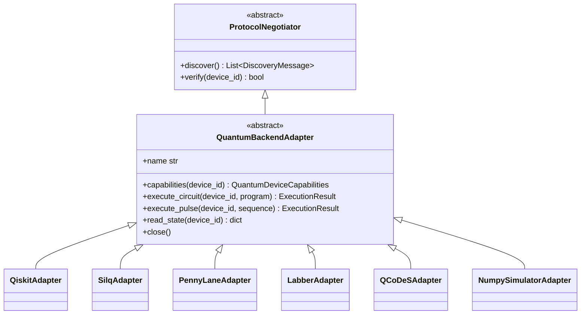
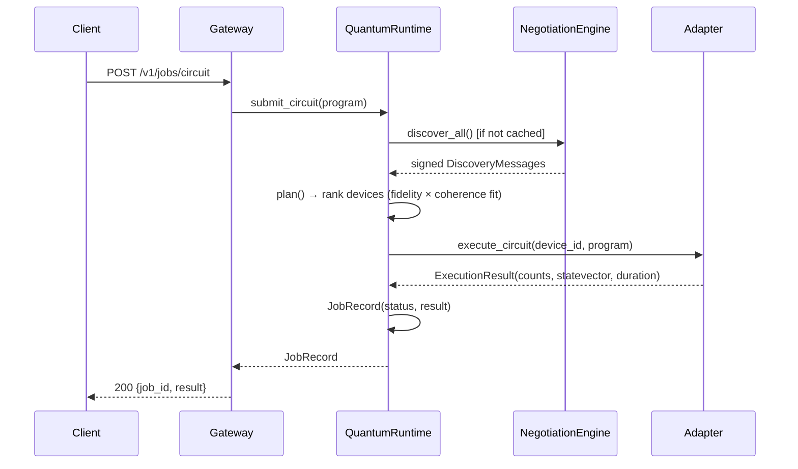

# Architecture

## 1. Layering

```mermaid
flowchart TD
    A["Application / Operator<br/>(ROS 2 node, CLI, HTTP client)"] --> B
    B["API Gateway — FastAPI<br/>REST + WebSocket, pydantic models, job store"] --> C
    C["QuantumRuntime facade<br/>discovery · planning · routing · errors · telemetry"] --> D
    D["Unified Quantum Abstraction Layer (core)<br/>capabilities · discovery · state · pulses · timing"]
    D --> E1["QiskitAdapter"]
    D --> E2["SilqAdapter"]
    D --> E3["PennyLaneAdapter"]
    D --> E4["LabberAdapter"]
    D --> E5["QCoDeSAdapter"]
    D --> E6["NumpySimulatorAdapter"]
    E4 -.JSON-RPC 2.0.-> F1["Labber bridge (instrument host)"]
    E5 -.Python API.-> F2["QCoDeS Station / instruments"]
    E1 -.primitives.-> F3["Qiskit sampler / Aer / IBM"]
    E3 -.QNode.-> F4["PennyLane default.qubit"]
```

Design rule: **`core` imports only numpy.** Vendors are behind adapters, so discovery,
planning and telemetry work even with no SDK installed.

## 2. Adapter contract

An adapter implements both halves of the control loop:



Because discovery and execution live on one object, `QuantumRuntime` keeps a
`device_id → adapter name` routing table and never needs a separate capability
registry.

## 3. Job lifecycle



`status` values: `completed`, `failed`, `delegated` (pulse handed to another
layer, e.g. a Qiskit schedule export). Every job is retrievable by id, and
`/v1/telemetry` aggregates job counts, coherence status and error statistics.

## 4. Device selection ("planning")

`QuantumRuntime.plan()` scores each discovered device:

```
score = (two_qubit_fidelity × readout_fidelity) × (0.5 + 0.5 × coherence_score)
coherence_score = min(1, T_eff / estimated_duration_us)     # 1 when ideal
estimated_duration_us = depth × [(1-f)·t_1q + f·t_2q] / 1000
```

A device is only a candidate if it has enough qubits, supports the required
protocols and can hold the circuit (`fits_coherence`, default safety factor 0.5).
The plan returns the full ranked candidate list with reasons, so the choice is
auditable.

## 5. State and error model

`QuantumStateManager` per device:

| Concern | Implementation |
|---|---|
| Unitary evolution | eigendecomposition of Hermitian `H`; `U = V·diag(e^{-iEt})·V†` (exact) |
| Noise | Kraus map; amplitude damping then phase damping composed as `K = P_j·A_i` (trace-preserving) |
| Dephasing | `1/T2 = 1/(2T1) + 1/T_φ` |
| Fidelity decay | `min(exp(-t/T2), exp(-t/2T1))` — conservative |
| Logical error | `p_L ≈ A·(p/p_th)^((d+1)/2)`, `A=0.03`, `p_th=0.01`, odd `d ≥ 3` |
| Recovery | strategy registry per error class → checkpoint restore / recalibrate / renegotiate |

Error classes: `decoherence`, `measurement`, `gate`, `readout`, `transport`,
`protocol`. Strategies are async and registered in `QuantumErrorHandler`.

## 6. Timing model

Control loops have microsecond deadlines, so `TimingBudget` makes the allocation
explicit:

```python
budget = TimingBudget("feedback-cycle", total_us=2.0,
                      allocation={"measure": 0.6, "decide": 0.4, "drive": 0.8})
budget.start()
with budget.stage("measure"):
    ...
budget.check()          # raises DeadlineMiss if the whole step blew its budget
budget.report()         # per-stage elapsed, overruns, headroom
```

An overrun in a named stage is recorded even when the total still fits, so
telemetry can show which stage is drifting.

## 7. Concurrency model

* Everything on the runtime path is `async`; vendor SDK calls that block are
  pushed to threads (`asyncio.to_thread`) in the QCoDeS adapter.
* The Labber bridge is a real async TCP client: one reader task demultiplexes
  JSON-RPC responses onto futures by request id; calls are serialised by a lock
  so request/response ordering never depends on scheduling.
* The ROS 2 node owns a dedicated asyncio loop in a background thread and
  schedules runtime coroutines onto it with `run_coroutine_threadsafe`, because
  `rclpy` callbacks are synchronous.

## 8. Extension points

| Goal | Where |
|---|---|
| New vendor | subclass `QuantumBackendAdapter`, register in `QuantumRuntime._build_adapters` |
| New error policy | `ErrorPolicy` + `QuantumErrorHandler.register` |
| New envelope / gate | `core/pulses.py` `Envelope`, `sim/statevector.py` `GATES` |
| New REST route | `api/gateway.py` `create_app` |
| New ROS interface | `ros2_ws/src/qnrs_ros2/msg` or `srv`, then extend `bridge_logic` |
